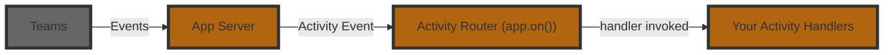

# Listening To Activities

An **Activity** is the Teams‑specific payload that flows between the user and your bot.
Where _events_ describe high‑level happenings inside your app, _activities_ are the raw Teams messages such as chat text, card actions, installs, or invoke calls.

The Teams SDK exposes a fluent router so you can subscribe to these activities with dedicated handler methods using minimal APIs.



Here is an example of a basic message handler:

**SDK 2.0 (Legacy):**

Slash commands arrive as targeted messages. Check `Recipient.IsTargeted` and handle them explicitly:

```csharp
app.OnMessage(async (context, cancellationToken) =>
{
    await context.Send($"you said: {context.Activity.Text}", cancellationToken);
});
```

**SDK 2.1 (current):**

```csharp
teams.OnMessage(async (context, cancellationToken) =>
{
    await context.SendAsync($"you said: {context.Activity.Text}", cancellationToken);
});
```

In the above example, the `context.Activity` property is of type `MessageActivity`, which has a `Text` property. You'll notice that the handler here does not return anything, but instead handles the activity by `Send`ing a message back. For message activities, Teams does not expect your application to return anything (though it's usually a good idea to send some sort of friendly acknowledgment!).

## Slash Commands

Slash commands are manifest-declared commands users run from the compose box. To enable slash commands, set `supportsTargetedMessages: true` in your app manifest (v1.29 or later) under the `bots` section. You can opt in with an explicit command list by declaring specific commands using `commandLists` with `triggers: ["slash"]`, which Teams shows in the slash menu when a user types `/`. Without a command list, users can still invoke your agent via `/agent-name` and provide free-form input.

```json
{
  "bots": [
    {
      "botId": "{{BOT_ID}}",
      "scopes": ["personal", "team", "groupChat"],
      "supportsTargetedMessages": true,
      "commandLists": [
        {
          "scopes": ["team", "groupChat"],
          "triggers": ["slash"],
          "commands": [
            { "title": "Review", "description": "Review a document" }
          ]
        }
      ]
    }
  ]
}
```

When a user sends a slash command, it appears as a private message visible only to them. Your agent can reply privately or, when appropriate, share a response with the broader group or channel.

Slash commands arrive as normal message activities with the targeted flag set on the activity's recipient object.

**SDK 2.0 (Legacy):**

Slash commands arrive as targeted messages. Check `Recipient.IsTargeted` and handle them explicitly:

```csharp
app.OnMessage(async (context, cancellationToken) =>
{
    if (context.Activity.Recipient?.IsTargeted == true)
    {
        await context.Send($"Received slash command: {context.Activity.Text}", cancellationToken);
    }
});
```

**SDK 2.1 (current):**

Slash commands arrive as targeted messages. Check `Recipient.IsTargeted` and handle them explicitly:

```csharp
teams.OnMessage(async (context, cancellationToken) =>
{
    if (context.Activity.Recipient?.IsTargeted == true)
    {
        await context.SendAsync($"Received slash command: {context.Activity.Text}", cancellationToken);
    }
});
```

## Activity handler chaining

In SDK 2.1, activity handlers no longer form a next()-style processing chain. Instead, every handler that matches an activity is invoked in the order it was registered, and one handler cannot prevent subsequent matching handlers from running. If you need to intercept, short-circuit, or wrap request processing (for example, to stop execution when a condition is met), implement `ITurnMiddleware` and control whether to call `nextTurn(...)`. See [turn middleware](./middleware.md) for details.

:::note[SDK 2.0 (Legacy)]
In SDK 2.0, activity handlers are chained. Call `context.Next()` to continue to the next matching handler; return without it to stop the chain. Registration order determines handler execution order.

```csharp
app.OnMessage(async (context, cancellationToken) =>
{
    if (context.Activity.Text == "/help")
    {
        await context.Send("Here are all the ways I can help you...", cancellationToken);
        return; // stop chain
    }

    await context.Next(); // continue chain
});

app.OnMessage(async (context, cancellationToken) =>
{
    await context.Send($"Hello! you said {context.Activity.Text}", cancellationToken);
});
```
:::
